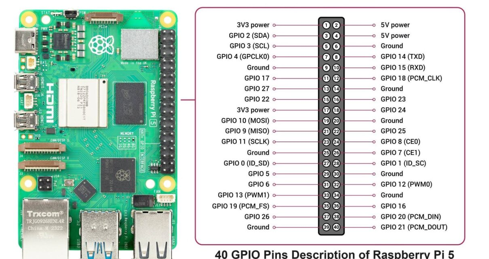
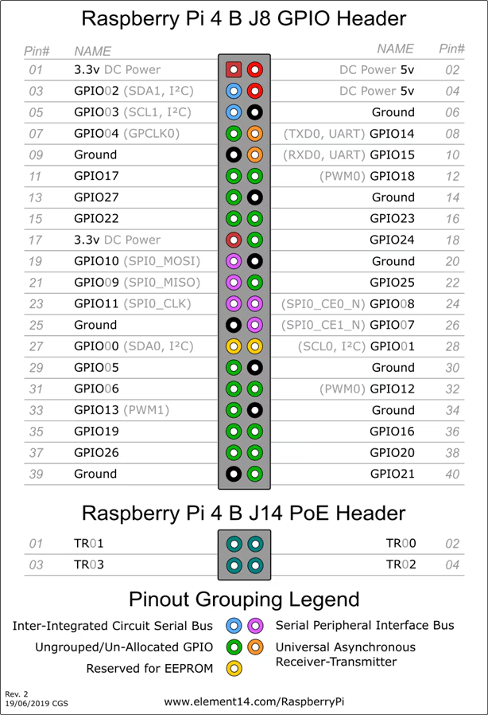

# Raspberry Pi hardwaretest (Pi 4 & Pi 5)

Eén SD-kaart die je van Pi naar Pi verplaatst. Bij elke boot test hij automatisch
de hardware en schrijft een rapport op de SD-kaart. Geen scherm of toetsenbord nodig.

## Testkaart maken

Je hoeft niets te installeren: er is een kant-en-klare image met alles erin.

1. Download **`pitest.img.xz`** (±1,4 GB) bij [Releases](../../releases) van deze repo.
2. Open **Raspberry Pi Imager**:
   - Apparaat: Raspberry Pi 4 of 5 (maakt niet uit, de kaart werkt in beide)
   - Besturingssysteem: scrol naar beneden → **Use custom** → kies `pitest.img.xz`
   - Opslag: je SD-kaart (minstens 8 GB, alles erop wordt gewist)
3. Vraagt Imager of je instellingen wil toepassen? Kies **Nee**. Alles zit al in de image.

Met balenaEtcher kan het ook: **Flash from file** → `pitest.img.xz` → kaart kiezen → **Flash**.

De eerste keer dat je de kaart opstart, breidt hij zich uit tot de volledige kaart en herstart hij één
keer. Daarna begint de test vanzelf.

Gegevens van de image:

|                        |                                                   |
| ---------------------- | ------------------------------------------------- |
| Hostname               | `pi-tester` (bereikbaar als `pi-tester.local`)    |
| Gebruiker / wachtwoord | `pitest` / `pitest`                               |
| SSH                    | aan, inloggen met wachtwoord                      |
| Wifi                   | niet ingesteld (de test gebruikt de netwerkkabel) |

Het wachtwoord staat bewust in deze README: het is een testkaart zonder gevoelige gegevens. Gebruik de
kaart wel niet als gewone Pi in een gedeeld netwerk.

## Een Pi testen

1. Kaart erin, **netwerkkabel erin**, eventueel USB-sticks in alle poorten.
2. Stroom aan met een **officiële voeding** (anders krijg je valse onderspanningsfouten).
3. Wacht tot de groene led verandert (~20 à 25 min met standaardinstellingen):

   | Groene led           | Betekenis         |
   | -------------------- | ----------------- |
   | traag knipperen (1s) | test bezig        |
   | hartslag (dubbel)    | geen fouten       |
   | snel knipperen       | minstens één FOUT |

4. Stroom eraf, kaart in je pc. Op de bootpartitie vind je:
   - `testrapport-<serienummer>-<datum>.txt`: het volledige rapport
   - `pitest-overzicht.csv`: één regel per geteste Pi (open in Excel)

## Opstarten vanaf een USB-stick (optioneel)

Dezelfde `pitest.img.xz` kan ook op een USB-stick in plaats van een SD-kaart. Flash hem op dezelfde
manier. De SD-kaart blijft de betere keuze voor onbekende Pi's: die werkt altijd, ook op oude Pi 4's,
en test de SD-sleuf mee. Een stick is vooral handig als je vermoedt dat de SD-sleuf zelf kapot is.

**Opstarten:**

- Er mag **geen SD-kaart** in de Pi zitten. Een Pi probeert eerst de SD-kaart en pas daarna USB.
- Een **oudere Pi 4** start misschien niet van USB. Opstarten van USB werkt pas met een nieuwere
  bootloader. Die update je één keer:
  - met een SD-kaart via Raspberry Pi Imager: **Misc utility images** → **Bootloader** → **USB Boot**
  - of op een draaiende Pi met `sudo rpi-eeprom-update -a`
- Een **Pi 5** start alleen van USB met de officiële **27 W-voeding**. Met een zwakkere voeding weigert
  hij, omdat hij dan te weinig stroom naar USB kan sturen.

**Wat de test dan anders meet:**

- De opslagtest test de USB-stick, niet meer de SD-sleuf van de Pi.
- De USB-test ziet de opstartstick als apparaat en geeft dus **OK**. Dat bewijst alleen dat die ene
  poort werkt, niet de andere drie.

## Live meekijken (optioneel)

Wil je zien hoe ver de test staat? Log in via SSH (`ssh pitest@pi-tester.local`, wachtwoord `pitest`)
en gebruik:

```bash
systemctl status pitest     # loopt de test nog?
journalctl -fu pitest       # volg de test live
```

Bij `systemctl status` betekent `activating (start)` dat de test nog bezig is. `inactive (dead)` met
`status=0/SUCCESS` betekent klaar zonder fouten, `status=1` betekent minstens één FOUT.

Met `journalctl -fu pitest` verschijnt er per afgewerkte test een regel. Stoppen met meekijken doe je
met `Ctrl+C`; de test zelf loopt gewoon verder. Zo ziet een volledige, geslaagde run eruit op een Pi 4:


Zo lees je die uitvoer:

- **`[OK] ...` / `[LET OP] ...`**: het resultaat van één test, in dezelfde volgorde als het rapport.
- **Stilte tussen twee regels is normaal.** Een regel verschijnt pas als een test klaar is. De RAM-test
  (hier 22:35 → 22:43) en de CPU-belasting (22:43 → 22:53) duren elk een paar minuten.
- **`stress-ng: invoked with ...`**: de start van de CPU-belasting op alle kernen.
- **`Rapport: /boot/firmware/testrapport-...txt`**: het rapport is weggeschreven, de test is klaar.
- **`Deactivated successfully`**: de service is netjes gestopt.
- **`Consumed 47min 47s CPU time`**: geen fout, maar de opgetelde processortijd van alle kernen samen.
  10 minuten belasting op 4 kernen is 40 minuten, plus ongeveer 8 minuten RAM-test op één kern.
- **`[LET OP] USB-poorten`** zoals hier: er zat geen USB-stick in. Steek sticks in om de poorten te testen.

Een eerste regel met een vreemde tijd (bv. `Starting pitest.service` om 21:58) is ook normaal. Een Pi
heeft geen klokbatterij en gebruikt bij het opstarten de laatst bekende tijd, tot hij de juiste tijd van
internet haalt.

## Wat wordt er getest

| Test                      | Wat het opspoort                                   |
| ------------------------- | -------------------------------------------------- |
| Bord & geheugengrootte    | RAM dat niet (volledig) herkend wordt              |
| Ethernet                  | defecte poort, geen gigabit, geen internet         |
| Wifi                      | defecte wifi-chip of antenne                       |
| Bluetooth                 | ontbrekende adapter                                |
| USB-poorten               | lijst van herkende apparaten                       |
| Opslag schrijven/lezen    | datacorruptie, trage of foutieve SD/NVMe           |
| RAM-geheugentest          | defecte geheugencellen                             |
| CPU-belasting             | crashes onder belasting, oververhitting            |
| Voeding & throttling      | onderspanning, throttling (ook tijdens stresstest) |
| GPIO-loopback (optioneel) | defecte GPIO-pinnen                                |

## Instellen

Pas `pitest.conf` op de bootpartitie aan, gewoon vanaf je pc. Daar stel je de duur van
de stresstest, de hoeveelheid RAM-test en optioneel GPIO-pinparen in.

### GPIO-pinnen testen met een brug (optioneel)

Met een **brug** (een jumperdraadje tussen twee pinnen) kan de Pi zijn eigen GPIO-pinnen
testen. Zonder brug wordt deze test overgeslagen.

**Zo werkt het:** de Pi zet de ene pin van het paar hoog en laag en leest op de andere pin
of dat aankomt. Daarna draait hij het om. Komt het signaal niet door, dan is een van beide
pinnen defect (of zit de draad los).

**Zo doe je het:**

1. **Zet de Pi uit** en haal de voeding eruit. Draadjes aansluiten onder spanning kan een
   kortsluiting geven.
2. Verbind twee pinnen met een female-female jumperdraadje. Gebruik de **pinnummers op de
   header** (1 t/m 40, zie het schema hieronder), niet de GPIO-nummers.
3. Zet de **GPIO-nummers** van die twee pinnen in `pitest.conf`, gescheiden door een
   streepje: `gpio_pairs = 17-27`.
4. Start de Pi weer op. In het rapport staat per richting of de pinnen werken.

**Voorbeelden** (de pinnen liggen naast elkaar, handig voor een korte draad):

| Brug tussen pin | GPIO-nummers    | Instelling in `pitest.conf` |
| --------------- | --------------- | --------------------------- |
| 11 en 13        | GPIO17 – GPIO27 | `gpio_pairs = 17-27`        |
| 15 en 16        | GPIO22 – GPIO23 | `gpio_pairs = 22-23`        |

Meerdere bruggen tegelijk? Scheid de paren met een komma: `gpio_pairs = 17-27, 22-23`.
Gebruik elke pin maar in één paar.

De 40-pins header heeft dezelfde indeling op de Pi 4 en de Pi 5. Links in elk schema
staan de oneven pinnen (1, 3, 5, …), rechts de even pinnen (2, 4, 6, …).

#### Raspberry Pi 5



#### Raspberry Pi 4 B



**Let op:**

- Verbind **nooit** een GPIO-pin met een `3V3`-, `5V`- of `Ground`-pin. Dat kan de Pi
  beschadigen. Gebruik alleen pinnen waar `GPIO` bij staat.
- Vermijd `GPIO 2` en `GPIO 3` (pin 3 en 5): die hebben een vaste pull-up-weerstand
  en geven kans op een vals resultaat.
- De GPIO-test is nog niet op echte hardware gecontroleerd; meld het als de uitslag
  niet klopt.

## Goed om te weten

- Een **FOUT** bij opslag kan ook aan de SD-kaart liggen in plaats van aan de Pi.
  Test bij twijfel met een tweede kaart.
- "Onderspanning" bijna altijd: de voeding of kabel, niet de Pi.
- Een Pi 4 of 5 zonder koeler wordt tijdens de stresstest warm; een **LET OP** voor
  temperatuur is dan normaal, geen defect.
- De USB-test toont wat herkend wordt; controleer zelf of elke stick die je insteekt
  in de lijst staat.

## Zelf de image bouwen

Alleen nodig als je de code aanpast. Zo is `pitest.img.xz` gemaakt:

1. Flash **Raspberry Pi OS Lite (64-bit)** met Raspberry Pi Imager, met deze instellingen:
   hostname `pi-tester`, gebruiker `pitest` / `pitest`, land `BE`, **SSH aan** met wachtwoord,
   geen wifi, geen Raspberry Pi Connect.
   Gebruik een **kleine kaart** (8 of 16 GB): het lezen in stap 5 gaat dan sneller.
2. Start een Pi met die kaart en een netwerkkabel. Kopieer deze map erheen en installeer
   (vanuit Windows met PowerShell):

   ```bash
   scp -r pi-hardwaretest pitest@pi-tester.local:
   ssh pitest@pi-tester.local
   cd pi-hardwaretest
   sudo bash install.sh
   ```

   Gebruik `sudo bash install.sh`: na kopiëren vanaf Windows is het bestand niet meer uitvoerbaar.
3. Test of alles werkt met `sudo systemctl start pitest` en `journalctl -fu pitest`.
4. Ruim op en sluit af:

   ```bash
   sudo rm -f /boot/firmware/testrapport-*.txt /boot/firmware/pitest-overzicht.csv
   rm -rf ~/pi-hardwaretest
   sudo shutdown -h now
   ```

5. Lees de kaart in Windows uit met **Win32 Disk Imager**: kies een bestand `pitest.img`,
   kies de kaart en klik **Lezen** (niet Schrijven!). Vraagt Windows om de kaart te formatteren:
   **Annuleren**.
6. Verklein en pak in met [PiShrink](https://github.com/Drewsif/PiShrink) in WSL (Ubuntu, niet de
   `docker-desktop`-omgeving):

   ```bash
   sudo apt install -y parted xz-utils
   wget https://raw.githubusercontent.com/Drewsif/PiShrink/master/pishrink.sh
   chmod +x pishrink.sh && sudo mv pishrink.sh /usr/local/bin/
   sudo pishrink.sh -Z -a /mnt/d/pad/naar/pitest.img
   ```

   Resultaat: `pitest.img.xz` (van 30 GB naar ±1,4 GB). Zet dat bestand in een nieuwe Release.

## Code-structuur

```txt
pitest/
  core/       basisklassen: Check, CheckResult, Shell, Config
  hardware/   bordinfo, vcgencmd, status-led
  checks/     één bestand per hardwareonderdeel
  report/     tekstrapport en CSV-overzicht
  suite.py    voert de tests uit en bepaalt het eindoordeel
```

Een test toevoegen: maak een subklasse van `Check` in `checks/` en voeg hem toe in
`build_checks()` in `__main__.py`.
